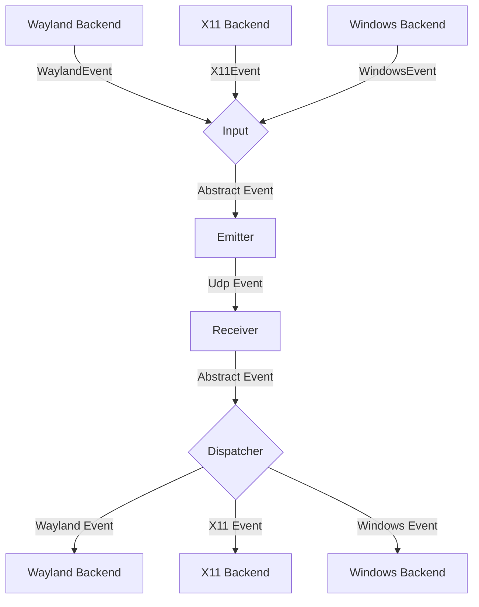
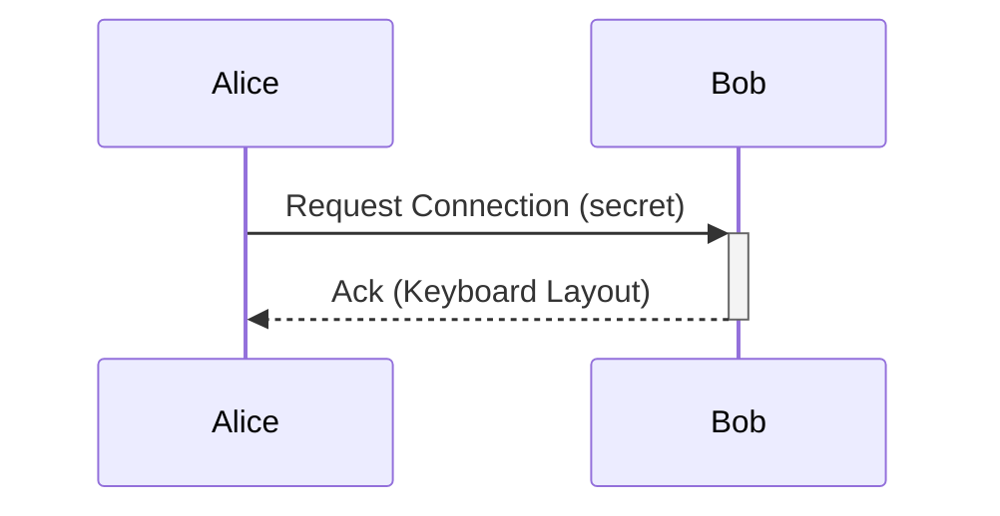

# General Software Architecture

## Events

Each instance of lan-mouse can emit and receive events, where
an event is either a mouse or keyboard event for now.

The general Architecture is shown in the following flow chart:


### Input
The input component is responsible for translating inputs from a given backend
to a standardized format and passing them to the event emitter.

### Emitter
The event emitter serializes events and sends them over the network
to the correct client.

### Receiver
The receiver receives events over the network and deserializes them into
the standardized event format.

### Dispatcher
The dispatcher component takes events from the event receiver and passes them
to the correct backend corresponding to the type of client.


## Clipboard Channel

Clipboard content does not fit the fixed-size event datagram, so it
travels on a second, independent channel:

```
UDP :4242  DTLS   -> input events (13 bytes, loss tolerant, low latency)
TCP :4242  TLS    -> clipboard frames (length prefixed, reliable, ordered)
```

TCP and UDP port namespaces are independent, so both use the configured
`port` and no extra key is needed. The two channels share the same
certificate: a peer presents one identity and one fingerprint, and the
server accepts a clipboard connection only from a fingerprint listed in
`authorized_keys`.

Because the channels are separate, a clipboard transfer of any size
cannot delay pointer or key events, and a peer running an older build
that has no clipboard channel still exchanges input exactly as before.

Frames are laid out as:

```
u32 frame_len (big endian)
  u64 origin_seq      <- sender's clipboard change counter
  u16 n_items
  n_items * { u16 name_len, name, u32 data_len, data }
```

`origin_seq` lets a receiver recognize the echo of content it just
pushed, which is what stops two machines from bouncing the same
clipboard back and forth.

## Frontend Protocol (local IPC)

The graphical frontend and the `cli` subcommand talk to the lan-mouse
service over a documented, self-describing local socket protocol. It does
not depend on the service's internal types: a frontend can be written in
any language from this section alone.

### Transport

| Platform | Endpoint |
| --- | --- |
| Linux | unix socket `$XDG_RUNTIME_DIR/lan-mouse-socket.sock` |
| macOS | unix socket `$HOME/Library/Caches/lan-mouse-socket.sock` |
| Windows | TCP `127.0.0.1:5252` |

Messages are UTF-8, newline-delimited JSON: one JSON document per line,
no binary framing, no length prefixes. Requests flow from the frontend
to the service, events flow from the service to the frontend, over the
same connection.

### Handshake

A frontend SHOULD send a `Hello` request as its first message to
negotiate the protocol version:

```json
{"Hello":{"version":1,"capabilities":["example-capability"]}}
```

The service answers on the same connection with its own version and the
capabilities it implements (currently none):

```json
{"Hello":{"version":1,"capabilities":[]}}
```

Capabilities are opaque strings; a side that receives a capability it
does not know MUST ignore it. The `example-capability` in the request
above only illustrates the shape.

- If the version does not match what the service supports, the service
  replies with an explicit error and closes the connection. A frontend
  MUST report that error instead of rendering partial state:

  ```json
  {"Error":"incompatible frontend protocol version 99: this service speaks version 1"}
  ```

- A frontend whose first message is anything else is treated as a
  *legacy frontend* (version 0, no capabilities). It works as before and
  receives no `Hello` reply. This keeps the GTK frontend and the CLI
  working unmodified.

The protocol version is currently `1`.

### Initial state

When a connection is accepted, the service broadcasts the complete
current state to it: an `Enumerate` event with all clients, then
`EmulationStatus`, `CaptureStatus`, `PortChanged`,
`PublicKeyFingerprint`, `AuthorizedUpdated`, `ClipboardStatus` and
`ClipboardSyncEnabled`. A frontend therefore never holds state of its
own and always shows the same picture, no matter when it starts.

### Requests (frontend → service)

Every request is one JSON object. The shape follows serde's externally
tagged enum encoding: unit variants are bare strings, newtype variants
unwrap a single value, tuple variants carry a JSON array.

| Request | JSON | Meaning |
| --- | --- | --- |
| `Hello` | `{"Hello":{"version":1,"capabilities":[]}}` | handshake, first message only |
| `Activate` | `{"Activate":[0,true]}` | activate/deactivate a client (capture starts/stops) |
| `Create` | `"Create"` | add a new client |
| `Delete` | `{"Delete":0}` | remove a client |
| `Enumerate` | `{"Enumerate":[]}` | request the full client list |
| `Sync` | `"Sync"` | request a full state resync |
| `ResolveDns` | `{"ResolveDns":0}` | resolve a client's hostname |
| `UpdateHostname` | `{"UpdateHostname":[0,"laptop"]}` | set a hostname, `null` clears it |
| `UpdatePort` | `{"UpdatePort":[0,4242]}` | set a client's port |
| `UpdatePosition` | `{"UpdatePosition":[0,"left"]}` | set a client's screen edge |
| `UpdateFixIps` | `{"UpdateFixIps":[0,["192.168.1.10"]]}` | set fixed ips, replacing all |
| `UpdateEnterHook` | `{"UpdateEnterHook":[0,"notify-send entered"]}` | set the enter hook command, `null` clears |
| `UpdateLeaveHook` | `{"UpdateLeaveHook":[0,"notify-send left"]}` | set the leave hook command, `null` clears |
| `ChangePort` | `{"ChangePort":4242}` | change the service listen port |
| `EnableCapture` | `"EnableCapture"` | re-enable input capture after a failure |
| `EnableEmulation` | `"EnableEmulation"` | re-enable input emulation after a failure |
| `AuthorizeKey` | `{"AuthorizeKey":["laptop","ab:cd"]}` | authorize a fingerprint (description, fingerprint) |
| `RemoveAuthorizedKey` | `{"RemoveAuthorizedKey":"ab:cd"}` | revoke a fingerprint |
| `SetClipboardEnabled` | `{"SetClipboardEnabled":true}` | enable/disable clipboard sharing on this machine |
| `SaveConfiguration` | `"SaveConfiguration"` | persist the current configuration |

Client handles are `u64`. Positions are the lowercase strings
`"left"`, `"right"`, `"top"`, `"bottom"`. IP addresses and socket
addresses are their string forms (`"192.168.1.10"`,
`"192.168.1.10:4242"`).

### Events (service → frontend)

| Event | JSON | Meaning |
| --- | --- | --- |
| `Hello` | `{"Hello":{"version":1,"capabilities":[]}}` | handshake reply |
| `Created` | see below | a client was created (e.g. by another frontend or a config reload) |
| `State` | see below | a client's config and/or state changed |
| `Deleted` | `{"Deleted":0}` | a client was removed |
| `NoSuchClient` | `{"NoSuchClient":7}` | a request referenced an unknown handle |
| `Enumerate` | see below | full client list, part of the initial sync |
| `PortChanged` | `{"PortChanged":[4242,null]}` | new listen port; the second value is the failure reason, if the change failed |
| `CaptureStatus` | `{"CaptureStatus":"Enabled"}` | `"Enabled"` or `"Disabled"` |
| `EmulationStatus` | `{"EmulationStatus":"Disabled"}` | `"Enabled"` or `"Disabled"` |
| `AuthorizedUpdated` | `{"AuthorizedUpdated":{"ab:cd":"laptop"}}` | all authorized fingerprints (fingerprint → description) |
| `PublicKeyFingerprint` | `{"PublicKeyFingerprint":"aa:bb:cc:dd"}` | this machine's fingerprint |
| `DeviceConnected` | `{"DeviceConnected":{"addr":"192.168.1.10:4242","fingerprint":"ab:cd"}}` | an authorized device connected |
| `DeviceEntered` | `{"DeviceEntered":{"fingerprint":"ab:cd","addr":"192.168.1.10:4242","pos":"left"}}` | a device took over the screen |
| `IncomingDisconnected` | `{"IncomingDisconnected":"192.168.1.10:4242"}` | a device disconnected |
| `ConnectionAttempt` | `{"ConnectionAttempt":{"fingerprint":"ab:cd"}}` | an unauthorized device wants to pair |
| `ClipboardStatus` | `{"ClipboardStatus":"..."}` | clipboard degradation or transfer notice, `null` clears it |
| `ClipboardSyncEnabled` | `{"ClipboardSyncEnabled":true}` | whether clipboard sharing is enabled on this machine, part of the initial sync |
| `Error` | `{"Error":"..."}` | an error occurred |

`Created`, `State` and `Enumerate` carry a client handle with its
configuration and state objects:

```json
{"State":[0,
  {"hostname":"laptop","fix_ips":["192.168.1.10"],"port":4242,"pos":"left","cmd":null,"leave_cmd":null},
  {"active":true,"active_addr":"192.168.1.10:4242","alive":true,"dns_ips":["192.168.1.11"],"ips":["192.168.1.10"],"has_pressed_keys":false,"resolving":false,"peer_commit":[171,205,18,52,86,120,154,188]}]}
```

The configuration object holds what the user configured: `hostname`
(may be `null`), `fix_ips`, `port`, `pos`, and the optional hook
commands `cmd` (enter) and `leave_cmd` (leave). The state object holds
what the service knows at runtime: `active`, the last known
`active_addr`, whether the client is `alive`, resolved `dns_ips` and
all known `ips`, whether keys are currently pressed
(`has_pressed_keys`), whether a DNS lookup is `resolving`, and the
peer's 8-byte build commit (`peer_commit`, `null` if not yet received).
`Enumerate` wraps a list of `[handle, config, state]` triples.

A frontend that receives an event it does not know MUST ignore it; new
variants are additive.

## Requests

// TODO this currently works differently

Aside from events, requests can be sent via a simple protocol.
For this, a simple tcp server is listening on the same port as the udp
event receiver and accepts requests for connecting to a device or to
request the keymap of a device.



## Problems
The general Idea is to have a bidirectional connection by default, meaning
any connected device can not only receive events but also send events back.

This way when connecting e.g. a PC to a Laptop, either device can be used
to control the other.

It needs to be ensured, that whenever a device is controlled the controlled
device does not transmit the events back to the original sender.
Otherwise events are multiplied and either one of the instances crashes.

To keep the implementation of input backends simple this needs to be handled
on the server level.

## Device State - Active and Inactive
To solve this problem, each device can be in exactly two states:

Either events are sent or received.

This ensures that
- a) Events can never result in a feedback loop.
- b) As soon as a virtual input enters another client, lan-mouse will stop receiving events,
which ensures clients can only be controlled directly and not indirectly through other clients.

